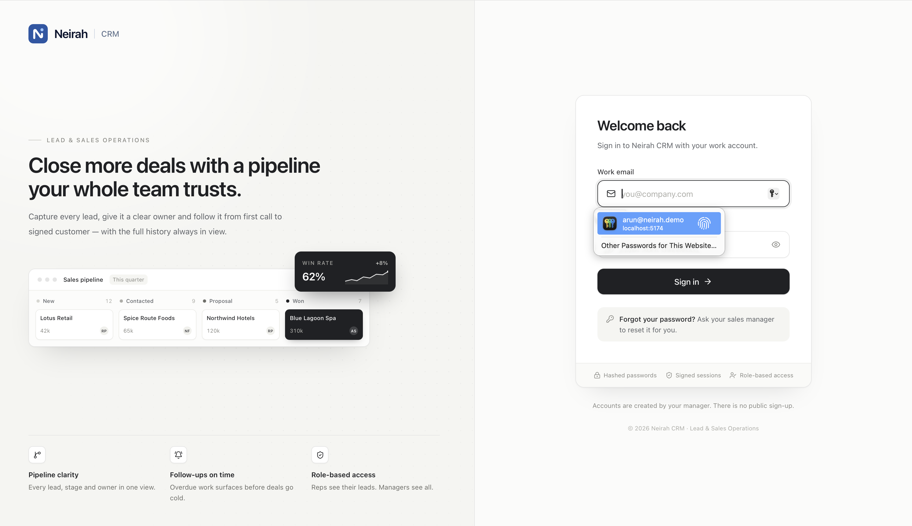

# Neirah CRM – Lead Management & Automated Follow-up System

A role-based CRM module for capturing leads, assigning ownership, tracking the sales pipeline,
scheduling follow-ups and converting won leads into customers without losing history.

Built with **Spring Boot 4 (Java 21) · React 19 + Vite · MySQL · JWT**.



---

## Contents

1. [Features](#features)
2. [What each role can do](#what-each-role-can-do)
3. [Project structure](#project-structure)
4. [Prerequisites](#prerequisites)
5. [Environment variables](#environment-variables)
6. [Setup and run](#setup-and-run)
7. [Demo accounts and seed data](#demo-accounts-and-seed-data)
8. [Running the tests](#running-the-tests)
9. [API documentation](#api-documentation)
10. [Design documents](#design-documents)
11. [Assumptions and design decisions](#assumptions-and-design-decisions)
12. [Known limitations](#known-limitations)
13. [Demo walkthrough](#demo-walkthrough)
14. [Demo video](#demo-video)

---

## Features

| Area | What is implemented |
|---|---|
| Authentication | JWT login, BCrypt password hashing, 401 on missing or expired tokens (the frontend then logs out automatically). No public sign-up: managers create sales rep accounts. A password reset ends the user's existing sessions |
| Roles | **Manager** sees and manages every lead. **Sales Rep** sees and updates only the leads they own |
| Lead records | Create, edit, list, search (including phone digits), filter (status, priority, owner) and paginate newest first |
| Assignment | Manager-only assign/reassign. Every change is written to an audit log. Notes and history are kept, and open follow-ups move to the new owner |
| Pipeline | `NEW → CONTACTED → QUALIFIED → PROPOSAL_SENT → WON`, and any open stage → `LOST`, with transitions validated on the server |
| Follow-ups | Dated calls, meetings and tasks; mark complete; upcoming, overdue and completed views |
| Activity timeline | Notes, calls and meetings merged with owner changes, status changes and conversions, each showing who did it and when |
| Duplicate detection | Email and phone are normalised before comparing. The user is warned and must confirm before a duplicate is created |
| Conversion | Won lead → customer. Transactional and idempotent: a repeat request returns the existing customer, and a Won lead whose email matches an existing customer is linked to that customer instead of creating a duplicate |
| Dashboard | Counts by stage, overdue follow-ups, conversion rate, win rate and won deal value. Managers also get a **Team performance** section: open, won and lost leads per rep, reps with overdue follow-ups, and recently added reps |
| User management (manager) | Sales team page with workload per rep (open leads, won deals, win rate, overdue follow-ups), search, filters, sorting and pagination. A details drawer per rep, **Add sales rep** and **Reset password** |
| Customers (manager) | Every customer across the team, with search, owner and source filters, sorting and pagination. A customer profile drawer shows contact details, linked won deals, follow-ups and the full activity history. Managers can **reassign the account owner** and **log interactions** (note, call or meeting) |
| Interface | Responsive single-page app (desktop, tablet and mobile) with loading, empty and error states, confirmation dialogs for sensitive actions, and success notifications |
| Reliability | Optimistic locking (`@Version`) on leads, a row lock during conversion, one error format for every API error, and application logging |

## What each role can do

The backend enforces every rule below. The frontend also hides manager-only pages from sales reps,
but that's a convenience, not the security boundary.

| Capability | Manager | Sales Rep | Where in the app |
|---|---|---|---|
| View leads | All leads | Own leads only | **Leads**, **Sales pipeline** |
| Create and edit leads, change stage, log activities | Any lead | Own leads only | **Leads**, lead details |
| Assign or reassign a lead | ✅ (to Sales Reps only) | ❌ | Lead details |
| Convert a Won lead to a customer | Any lead | Own leads only | Lead details |
| Follow-ups (schedule, complete, overdue view) | All leads | Own leads only | **Follow-ups**, lead details |
| Dashboard and reports | Whole team, plus Team performance | Own figures only | **Overview**, **Reports & analytics** |
| View the sales team and each rep's workload | ✅ | ❌ | **User management** |
| Create a sales rep account | ✅ | ❌ | **User management** → *Add sales rep* |
| Reset a sales rep's password (signs them out everywhere) | ✅ | ❌ | **User management** → rep → *Reset password* |
| View all customers and customer profiles | ✅ | ❌ (page is manager-only) | **Customers** |
| Reassign a customer's account owner | ✅ | ❌ | **Customers** → customer → *Reassign owner* |
| Log a note, call or meeting on a customer | ✅ | ❌ (page is manager-only) | **Customers** → customer → *Log interaction* |

### User management (`/users`, manager only)

- **Team list:** each Sales Rep with ID, name, email, role, open leads, won deals, win rate and overdue follow-ups. Search by name or email, filter by workload (*Has overdue*, *No open leads*), sort by name, newest added, most open leads or most overdue, 8 per page.
- **Rep details:** account details, workload figures, and lists of the rep's overdue follow-ups and open leads (each links to the lead).
- **Add sales rep:** full name, work email and a temporary password (at least 8 characters). A duplicate email is rejected with a clear message.
- **Reset password:** a confirmation dialog names the rep. The new password must be at least 8 characters and is typed twice. The rep is signed out of every device immediately, and the password is never shown or stored by the app afterwards.

Uses: `GET /users/sales-reps`, `POST /users/sales-reps`, `PUT /users/reset-password/{email}`, plus `GET /leads` and `GET /follow-ups?status=OVERDUE` for the workload figures.

### Customers (`/customers`, manager only)

- **Customer list:** name, email, company, phone, account owner, lead source, won deal value and *Customer since* date. Customers with several won deals are marked. KPIs show total customers, won deal value, new customers this month, and won leads still awaiting conversion, each linked to its lead.
- **Search and filters:** search by name, email, company or phone digits; filter by account owner and lead source; sort by newest, oldest, name or highest value; 10 per page.
- **Customer profile:** contact details (clickable email and phone), customer ID, account owner, lead source, lead creation and conversion dates, won deal value, linked won deals, follow-ups (done, overdue, upcoming), and one timeline of notes, calls, meetings, stage changes, owner changes and the conversion.
- **Reassign owner:** a confirmation dialog shows the current and new owner and explains the effect before anything changes.
- **Log interaction:** add a note, call or meeting (up to 2,000 characters) to the customer's history.

Uses: `GET /leads`, `GET /leads/{id}/customer`, `GET /leads/{id}/activities`, `GET /leads/{id}/audit-logs`, `GET /leads/{id}/follow-ups`, `PUT /leads/{id}/assign` and `POST /leads/{id}/activities`. See [Assumptions](#assumptions-and-design-decisions) for how the customer list is built.

## Project structure

```
CRM-Project/
├── backend/                         Spring Boot REST API
│   ├── src/main/java/com/neirah/backend/
│   │   ├── config/                  Security (JWT filter chain, CORS) and OpenAPI config
│   │   ├── controller/              REST controllers
│   │   ├── dto/                     Request/response records with validation
│   │   ├── entity/                  JPA entities and enums
│   │   ├── exception/               Global exception handler and ApiError format
│   │   ├── repository/              Spring Data repositories and queries
│   │   ├── security/                JWT service and authentication filter
│   │   ├── service/                 Business rules
│   │   └── util/                    Contact normalisation (email/phone)
│   ├── src/main/resources/db/migration/
│   │   ├── V1__initial_schema.sql   Tables, foreign keys, indexes
│   │   ├── V2__seed_demo_data.sql   Synthetic demo data
│   │   └── V3__customer_matching_and_session_versioning.sql   Customer matching, conversion audit, session versioning
│   ├── src/test/                    Unit and integration tests
│   └── docs/                        ER diagram, API contract, permissions, OpenAPI export, test evidence
├── frontend/                        React + Vite + Tailwind single-page app
│   └── src/
│       ├── api/                     Axios client (JWT header, logout on 401)
│       ├── context/                 Authentication state
│       ├── hooks/                   Shared hooks (notifications)
│       ├── pages/                   Login, Dashboard, Leads, LeadDetails, Pipeline, FollowUps,
│       │                            Reports, Users (manager), Customers (manager)
│       └── components/
│           ├── brand/               Neirah logo
│           ├── layout/              Sidebar, top bar, page layout
│           ├── leads/               Lead form
│           ├── dashboard/           Team performance section
│           ├── users/               Rep details drawer, add rep and reset password dialogs
│           ├── customers/           Customer data loading, profile drawer, reassign dialog
│           └── ui/                  Dialog, drawer and notification building blocks
├── image.png                        Screenshot used in this README
└── CRM-Project.postman_collection.json
```

## Prerequisites

| Tool | Version used |
|---|---|
| Java (JDK) | 21 |
| Maven | 3.9+ |
| MySQL | 8.0+ (tested on 9.5) |
| Node.js / npm | Node 20+ |

## Environment variables

Secrets are read from environment variables and are never committed.
`backend/.env.example` lists them; the values below are examples only.

| Variable | Required | Example | Purpose |
|---|---|---|---|
| `DB_PASSWORD` | Yes | `your_mysql_password` | Password for the MySQL `root` user (see `application.properties`) |
| `JWT_SECRET` | Yes | `a-long-random-string-of-at-least-32-characters` | HMAC key used to sign JWTs. Must be at least 32 bytes |

```bash
export DB_PASSWORD='your_mysql_password'
export JWT_SECRET='replace-with-a-long-random-secret-at-least-32-chars'
```

The database URL and username are in `backend/src/main/resources/application.properties`
(`jdbc:mysql://localhost:3306/crm_db`, user `root`).

## Setup and run

### 1. Create the database

```sql
CREATE DATABASE crm_db;
```

You only need to create the empty database. On first start, **Flyway** creates every table (`V1`)
and loads the demo data (`V2`), then applies the schema changes in `V3`. Hibernate then runs with `ddl-auto=validate`, which checks that the
schema matches the entities but never changes it.

### 2. Start the backend

```bash
cd backend
mvn spring-boot:run
```

The API runs at **http://localhost:8080**. You should see
`Successfully applied 3 migrations to schema crm_db` in the log.

### 3. Start the frontend (in a second terminal)

```bash
cd frontend
npm install
npm run dev
```

Open **http://localhost:5173**. The backend allows requests from ports 5173 and 5174 (CORS).

## Demo accounts and seed data

All seeded data is synthetic. Every account uses the password **`Demo@1234`**.

| Role | Email | Name |
|---|---|---|
| Manager | `manager@neirah.demo` | Maya Manager |
| Sales Rep | `ravi@neirah.demo` | Ravi Perera |
| Sales Rep | `nisha@neirah.demo` | Nisha Fernando |
| Sales Rep | `arun@neirah.demo` | Arun Silva |

The seed data (`V2__seed_demo_data.sql`) contains:

- **11 leads** across every stage: 3 New, 2 Contacted, 1 Qualified, 2 Proposal Sent, 2 Won, 1 Lost.
- **1 lead already converted** (Ruwan Dissanayake) and **1 Won lead ready to convert** (Sachini Abeysekara, owned by Arun).
- **3 overdue**, **4 upcoming** and **2 completed** follow-ups. One completed follow-up was finished after its due date, which shows that completed items are never counted as overdue.
- Audit history for every stage change and reassignment, including a lead reassigned from Nisha to Arun that keeps Nisha's earlier notes.
- One lead with no email and one with no phone, to show how missing values are handled.

Dates are relative to the time the migration runs, so overdue and upcoming items stay correct whenever you set up the project.
 
**Note on Follow-up Date Selection:**

Past dates are intentionally allowed when creating follow-ups. This is for testing and demonstration purposes, allowing testers to verify how the system handles overdue follow-ups and past-due tasks.

This is a deliberate testing decision, not an oversight.


> **Existing database:** if `crm_db` already had tables created by Hibernate, Flyway treats the
> current schema as version 1 (`baseline-on-migrate`) and applies `V2` and `V3` on top. Seed users are added
> with `INSERT IGNORE`, so existing accounts are not touched. `V3` adds a unique index on customer email, so it
> fails if your old data has two customers with the same email. For a clean demo, drop and recreate `crm_db`.

## Running the tests

```bash
cd backend
mvn test
```

**45 tests, all passing.** They run against an in-memory H2 database, so no MySQL or environment
variables are needed. The suite includes:

- **Unit tests** (Mockito) for lead rules, duplicate detection, assignment, audit events, follow-up overdue logic and conversion.
- **Integration tests** (MockMvc) that go through the real JWT security filter chain, controllers, services and database. They cover 401/403 handling, ownership checks, idempotent conversion, duplicate warnings, validation errors, role-scoped dashboards, and correct status codes (404, 405, 415) for unknown routes, methods and content types.

See **[backend/docs/Test-Evidence.md](backend/docs/Test-Evidence.md)** for the latest run output and a table mapping each test to a business rule.

The frontend has no automated test suite. To check it builds cleanly:

```bash
cd frontend
npm run build    # production build
npm run lint     # oxlint
```

## API documentation

| Resource | Location |
|---|---|
| Swagger UI (live) | http://localhost:8080/swagger-ui.html. Click **Authorize** and paste the JWT from `/auth/login` |
| OpenAPI JSON (live) | http://localhost:8080/v3/api-docs |
| OpenAPI export (snapshot) | [backend/docs/openapi.json](backend/docs/openapi.json) |
| API contract | [backend/docs/API-Contract.md](backend/docs/API-Contract.md) |
| Postman collection | [CRM-Project.postman_collection.json](CRM-Project.postman_collection.json). Run **Login** first; the token is saved automatically |

Every error response has the same shape:

```json
{
  "timestamp": "2026-11-27T17:18:31",
  "status": 400,
  "error": "Bad Request",
  "message": "Validation failed",
  "path": "/api/v1/leads",
  "fieldErrors": { "name": "Lead name is required" }
}
```

Status codes: `400` validation or business-rule violation · `401` not authenticated · `403` not permitted ·
`404` not found · `409` duplicate or concurrent-update conflict.

## Design documents

- ER diagram: [backend/docs/ER-Diagram.md](backend/docs/ER-Diagram.md) (Mermaid; GitHub renders it automatically)
- Role and permission matrix: [backend/docs/Role-Permission-Matrix.md](backend/docs/Role-Permission-Matrix.md)
- API contract: [backend/docs/API-Contract.md](backend/docs/API-Contract.md)

## Assumptions and design decisions

**Roles and access**
- **There is no public sign-up.** Only a manager can create a sales rep account (`POST /api/v1/users/sales-reps`). Manager accounts come from seed data. With open registration, any stranger could create an account and use the duplicate check to find out whether a person is one of Neirah's leads.
- Resetting a password ends that user's existing sessions immediately. Each token carries a version number, which the reset increments, so older tokens are rejected.
- A new lead is owned by the user who created it. Managers can then reassign it, but only to Sales Reps.
- Sales Reps see dashboard and report figures for their own leads only; managers see everything.
- Every check is enforced in the service layer on the server. Hiding buttons in the UI is only a convenience.

**Pipeline**
- Allowed transitions: `NEW→CONTACTED→QUALIFIED→PROPOSAL_SENT→WON`, and **any open stage → LOST**. Won can only be reached from Proposal Sent, and forward stages cannot be skipped. Spam or unresponsive leads can be closed early, so they don't stay "active" forever and distort the dashboard.
- **Won and Lost are final.** Reopening a closed lead is out of scope.
- Marking a lead Won stores the deal value and clears any loss reason. Marking it Lost does the opposite.

**Duplicate detection**
- **Email** is trimmed and lower-cased. **Phone** keeps digits only, so `+94 (77) 123-4567` matches `94771234567`.
- **Missing values:** a blank email or phone is stored as `NULL` and never counts as a match. Two leads with no phone number are therefore not duplicates.
- A match on either field triggers a warning. The user can still create the lead by confirming (`confirmDuplicate: true`), because two contacts can legitimately share a company phone line.
- When editing a lead, the duplicate check only runs if the email or phone **actually changes**. In that case the user sees the same warning and can choose to save anyway. A lead that was deliberately created as a duplicate can still be edited.
- If the matching lead belongs to another rep, the Sales Rep is told a match exists but cannot see its details.

**Audit and history**
- Audit events (owner and status changes) can only be inserted. The columns are mapped `updatable=false`, and the API has no update or delete endpoints for them.
- Reassignment changes `leads.owner_id` and moves **open** follow-ups to the new owner. Completed follow-ups keep their original assignee as history. Activities and audit rows reference the lead, not the owner, so nothing is lost.
- Conversions are recorded on the timeline as `CONVERTED` events.

**Follow-ups**
- Overdue means `completedAt IS NULL AND dueAt < now`. It is worked out on every request and never stored.
- **A follow-up always belongs to the lead owner.** Who can see and complete a follow-up depends on lead ownership (business rule 3), so assigning one to another rep would create a task they could neither see nor complete. The server rejects that with 400. To hand work over, reassign the lead.
- Completing a follow-up twice has no further effect.
- **Closed leads:** new follow-ups cannot be scheduled on Won or Lost leads, because those stages are final. The server rejects the request with 400. Follow-ups that were already open when the lead closed can still be marked complete, so reps can finish outstanding work.
- **Past due dates are allowed.** A rep may need to log a call they missed or record a task after the fact. Such a follow-up is reported as overdue immediately, until it is completed.

**Conversion and concurrency**
- Conversion runs in one transaction that locks the lead row (`SELECT … FOR UPDATE`), so two simultaneous requests for the same lead cannot create two customers.
- A repeated conversion request returns the existing customer with `alreadyConverted: true` instead of an error.
- **One customer per person:** if a Won lead's normalised email already belongs to a customer, the lead is linked to that customer (`linkedToExistingCustomer: true`) instead of creating a duplicate. Several Won leads (for example repeat deals) can point to the same customer through `leads.customer_id`. A unique index on `customers.email_normalized` enforces this even under concurrency.
- Customers are matched on **email only**, not phone, because phone lines can be shared by different people (the same reason duplicate leads only trigger a warning). Leads without an email always create a new customer.
- Leads use optimistic locking (`@Version`). If two saves of the same lead collide, the second gets a 409 conflict instead of silently overwriting the first.

**User management**
- The User management page lists **Sales Rep accounts only**, because that's what `GET /users/sales-reps` returns. Manager accounts aren't listed.
- Workload figures (open leads, won deals, win rate, overdue follow-ups) are calculated in the browser from the manager's lead list and overdue follow-ups. They aren't stored anywhere.
- **Newest added** sorts by user ID, because IDs are assigned in creation order and the API doesn't return a created date for users.
- Password reset works for Sales Reps only (the backend rejects other roles) and needs at least 8 characters.

**Customers**
- **How the list is built:** the backend has no "list customers" endpoint. The page takes every Won lead the manager can see, calls `GET /leads/{id}/customer` for each (up to 6 at a time), and groups leads that share a customer ID, so repeat deals appear under one customer. A Won lead that returns 404 hasn't been converted yet and is shown under *Awaiting conversion*.
- **Account owner** means the owner of the lead the customer was created from (`sourceLeadId`). That's the same rule the backend uses to decide which customers a Sales Rep can see.
- **Reassigning a customer** therefore reassigns that originating lead (`PUT /leads/{id}/assign`). The backend records an `OWNER_CHANGED` audit event and moves the lead's open follow-ups to the new owner; notes stay where they are. Other won deals linked to the same customer keep their own owners.
- **Logged interactions** are stored as activities on the customer's lead (the originating lead by default, or a chosen linked deal), because customers have no activity table of their own.
- The Customers page is manager-only in the app. The underlying endpoints are not: a Sales Rep can still read customers for their own leads through the API, and the backend limits them to those.

**Dashboard**
- **Conversion rate** = Won ÷ all visible leads × 100: how many enquiries become deals.
- **Win rate** = Won ÷ (Won + Lost) × 100: how many closed opportunities are won.
- Both are calculated on the server, so the Dashboard and Reports always show the same numbers.
- The Pipeline page shows **won deal value**. A deal value is recorded when a lead is marked Won, so open leads have no value to add up.

## Known limitations

- No email, SMS or WhatsApp notifications and no background reminder jobs. The PDF lists these as optional.
- **User management is limited to what the API supports:** create a Sales Rep and reset a Sales Rep's password. There is no account status (active/inactive), no editing user details, no role changes, no deactivation, and no API to list managers. The API returns no sign-up date or last sign-in for users.
- **Customer management is limited to what the API supports:** view, reassign the owner (through the originating lead), and log interactions. There is no customer status, no editing or deleting customers, no owner field on the customer itself, and no scheduling of follow-ups for customers (the backend rejects follow-ups on Won leads).
- **No `GET /customers` endpoint.** The Customers page makes one request per Won lead. That's fine at demo scale but would be slow with hundreds of customers; a paginated customers endpoint would fix it.
- Won and Lost leads cannot be reopened.
- Deal values are only recorded when a lead is Won; there is no estimated value for open opportunities.
- The client does not send the lead version with updates, so optimistic locking only catches saves that collide on the server. It does not detect a user editing from a stale page.
- `GET /leads` is not paginated; it feeds the dashboard and pipeline views. The paginated endpoint for large lists is `GET /leads/search`.
- JWTs last 24 hours. A password reset ends existing sessions, but there is no refresh token and no per-device logout.
- Times use the server's local time zone.
- Only the backend has automated tests; the frontend was checked manually.

## Demo walkthrough

Suggested 15–20 minute flow using the seed data:

**Successful workflows**
1. Log in as **`manager@neirah.demo`**. The dashboard shows counts by stage, 3 overdue follow-ups and the conversion rate. Scroll to **Team performance** to see each rep's open, won and lost leads and who has overdue follow-ups.
2. **Leads** → search, filter by status and priority, and page through results. Filtering by owner is available through the API (`ownerEmail`).
3. **Create a lead.** Enter the email `KASUN@LotusRetail.example` and the duplicate warning appears, listing the existing lead. Confirm to create it anyway, or cancel.
4. Open **Malini Herath**. The timeline shows she was reassigned from Nisha to Arun and that Nisha's notes were kept. Reassign her to Ravi and watch the new audit entry appear.
5. Log out and log in as **`arun@neirah.demo`**. He only sees his own leads. Open **Sachini Abeysekara** (Won) → **Convert to Customer** → click again and get *"already converted, no duplicate created"*.
6. Log out and log in as **`ravi@neirah.demo`**. **Follow-ups** → filter by Overdue. Malini's *Requirements workshop* now appears in his list, because it moved with the lead in step 4. Mark it complete and watch the overdue count go down.
7. Open **Kasun Jayawardena** and move him through the pipeline: New → Contacted, recording a call activity along the way.

**Manager: user management**

8. Log in as **`manager@neirah.demo`** and open **User management**. The table lists every Sales Rep with open leads, won deals, win rate and overdue follow-ups. Filter by **Has overdue**, then search by a name or email.
9. Click a rep to open their details: workload figures, overdue follow-ups and open leads, each linking to the lead.
10. **Reset password:** from a rep's row menu or details drawer, choose *Reset password*, enter a new password twice and confirm. A success message appears, and the rep must now sign in with the new password (their existing sessions end immediately).
11. **Add sales rep:** click *Add sales rep*, enter a name, email and temporary password. The new rep appears at the top of the list and can sign in straight away.

**Manager: customers**

12. Open **Customers**. Every converted customer across the team is listed with account owner, lead source, won value and *Customer since* date. Try the owner and source filters, sort by highest value, and search by phone digits.
13. Click a customer to open their profile: contact details, linked won deals, follow-ups and the full timeline, including the `CONVERTED` event.
14. **Log interaction:** add a call or note. It appears at the top of the timeline.
15. **Reassign owner:** choose a new Sales Rep, review the *current → new* summary and confirm. The owner updates in the profile and the table, and the change is recorded in the lead's history.

**Failure and edge cases**
1. Mark a Proposal Sent lead **Won with deal value 0**. It is rejected: *"Positive deal value is required"*.
2. Try **New → Won** directly. It is rejected: *"Invalid pipeline transition"*.
3. Mark a lead **Lost with no reason**. It is rejected.
4. As `ravi@neirah.demo`, open `/leads/<id of an Arun lead>`. The result is **403 Forbidden**.
5. In Postman, call any endpoint without a token. The result is **401** with the JSON error body.
6. As `ravi@neirah.demo`, go to `/users` or `/customers`. The app sends him back to the Overview, and the manager-only API (`GET /api/v1/users/sales-reps`) returns **403** if called directly.
7. As the manager, **Add sales rep** with an existing email such as `ravi@neirah.demo`. It is rejected: *"An account with this email already exists."*
8. **Reset password** with fewer than 8 characters, or with two different passwords. Each is blocked with a message before anything is sent.
9. On the login page, sign in with a wrong password. The backend's *"Invalid email or password"* is shown and no session is created.

## Demo video

[Watch the demonstration video (Google Drive)](https://drive.google.com/drive/folders/1kb3Kl3Lwbz0WT73jHY9pWRJy4oct5E3m?usp=sharing)

> This recording shows an earlier version of the interface, before the redesigned login page,
> User management and Customers were added. An updated video covering these will be added.
